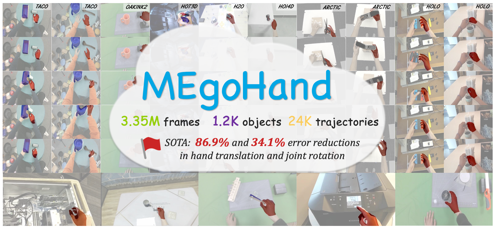

# MEgoHand: Multimodal Egocentric Hand-Object Interaction Motion Generation

<div align="center">

[](https://openreview.net/pdf/6869acbb30d7c3a7f8cafe695502f9891b30e804.pdf)
[](https://zhoubohan0.github.io/MEg0Hand)
[](https://scholar.googleusercontent.com/scholar.bib?q=info:J6S93qD9OogJ:scholar.google.com)

[]()
[]()



</div>

We propose MEgoHand, a multimodal framework that synthesizes physically
plausible hand-object interactions from egocentric RGB, text, and initial hand pose. 

- High-level "cerebrum": a vision language model (VLM) to infer motion priors from visual-textual context and a monocular depth estimator for object-agnostic spatial reasoning, while
- Low-level "cerebellum": a DiT-based policy generates fine-grained trajectories via flow-matching, along with temporal orthogonal filtering to enhance decoding smoothness.
- Dataset curation: Inverse MANO Retargeting Network and Virtual RGB-D Renderer are designed to unify diverse HOI datasets.


## Dataset
### Prepare Dataset
```bash
export dataset=taco
python -m mhmp_vis.dataset_loader.dataset_${dataset}
```

### Visualize Single Task in a Dataset
```bash
cd mhmp_vis
export dataset=fpha
export task="Subject_1/charge_cell_phone/1/106"

export dataset=hoi4d
export task="ZY20210800001/H1/C1/N19/S100/s02/T1"

export dataset=taco
export task="(dust, roller, pan)/20230927_032"

export dataset=h2o
export task="subject1/o1/7/cam4"

export dataset=arctic
export task="s01/box_use_02"

export dataset=hot3d
export task="train_aria/clip-002832"

export dataset=oakink2
export task="scene_04__A008/seq__ff070467cd91f735acab__2023-04-23-11-28-29"

export dataset=holo
export task="R0027-12-GoPro"

QT_XCB_GL_INTEGRATION=xcb_egl LIBGL_ALWAYS_INDIRECT=1 python -m pdb -m dataset_visualizer.general_offline_visualizer -d ${dataset} -t ${task}
```

### Calculate Statistics for CascadedDataset
for each dataset:
```bash
for dataset in arctic fpha h2o hoi4d hot3d taco oakink2; do
    bash bash/statistics.sh -dataset_list "${dataset}"
done
python model_config/get_metadata.py  # final pooling
```

### Use CascadedDataset
Run: 
```bash
python -m scripts.dataloading_example
```
Minimal example codes
```python
from gr00t.experiment.data_config import DATA_CONFIG_MAP
from mhmp_vis.dataset_loader import load_cascaded_dataset

data_config = DATA_CONFIG_MAP['hand_motion']
data_storage_kwargs = dict(window_size=16, side='right', is_render_depth=False)
# split whole train & evaluation dataset on server 
train_dataset, eval_dataset = load_cascaded_dataset(
    dataset_path='/mnt/vepfs/zbh/MHMP/datasets/',
    dataset_list='arctic,fpha,h2o,hoi4d,hot3d,taco'.split(','),
    split_portion=0.99,
    data_config=data_config,
    data_storage_kwargs=data_storage_kwargs,
    test=False,
    debug=False,
)
# load partial testing dataset locally
test_dataset = load_cascaded_dataset(
    dataset_path='/media/ps/zhan/DATASET/',
    dataset_list='fpha'.split(','),
    split_portion=0.99,
    data_config=data_config,
    data_storage_kwargs=data_storage_kwargs,
    test=True,
    debug=False,
)
```

## Training
```bash
# MHMP-lora (unused)
# bash bash/train.sh -dataset_list taco -depth_model_path "" -multimodal "tv" -exp_name TI_finetunelora -lora_rank 32 -tune_llm 1 -device "4,5,6,7"  # -resume "logs/RGB_lora/checkpoint-v0" -debug 1

# MHMP
bash bash/train.sh -batch_size 112 -depth_model_path "" -multimodal "tv" -exp_name TI_l1_6 -lora_rank 0 -tune_llm 0 -device "0,1,2,3,4,5,6,7" -dataset_list fpha,h2o,hoi4d,hot3d,taco,oakink2

# MHMP+DA
bash bash/train.sh -batch_size 80 -depth_model_path "/mnt/vepfs/zbh/backup/pretrain/depth_anything_v2/" -depth_mode "abs" -multimodal "tv" -exp_name TID_l1_6_DA -lora_rank 0 -tune_llm 0 -device "0,1,2,3,4,5,6,7" -dataset_list fpha,h2o,hoi4d,hot3d,taco,oakink2

# MHMP+UD
bash bash/train.sh -batch_size 60 -depth_model_path "/mnt/vepfs/zbh/backup/pretrain/unidepth/" -depth_mode "abs" -multimodal "tv" -exp_name TID_l1_6_UD -lora_rank 0 -tune_llm 0 -device "0,1,2,3,4,5,6,7" -dataset_list fpha,h2o,hoi4d,hot3d,taco,oakink2

# MHMP-T
bash bash/train.sh -batch_size 1700 -depth_model_path "" -multimodal "tv" -exp_name T_l1_6 -lora_rank 0 -tune_llm 0 -device "0,1,2,3,4,5,6,7" -dataset_list fpha,h2o,hoi4d,hot3d,taco,oakink2

# MHMP-V
bash bash/train.sh -batch_size 70 -depth_model_path "/mnt/vepfs/zbh/backup/pretrain/unidepth/" -depth_mode "abs" -multimodal "v" -exp_name ID_l1_6_UD -lora_rank 0 -tune_llm 0 -device "0,1,2,3,4,5,6,7" -dataset_list fpha,h2o,hoi4d,hot3d,taco,oakink2
```

Visualize logs as below. The checkpoint will be saved in $exp_dir/*
```bash
export exp_name=""
exp_dir=logs/$exp_name/runs/
tensorboard --logdir $exp_dir/*
```

## Testing and Visualization
```bash
export ckpt="logs/TID_l1_6_UD/checkpoint-50000"
bash bash/test.sh -dataset_list arctic, -split_portion 0.0 -pretrain_ckpt ${ckpt}
```

## Citation
More Visualization can be found on our [[Website]](https://zhoubohan0.github.io/MEg0Hand/).
If you find our work useful, please consider citing us!
```
@article{zhou2025megohand,
  title={MEgoHand: Multimodal Egocentric Hand-Object Interaction Motion Generation},
  author={Zhou, Bohan and Zhan, Yi and Zhang, Zhongbin and Lu, Zongqing},
  journal={arXiv preprint arXiv:2505.16602},
  year={2025}
}
```
